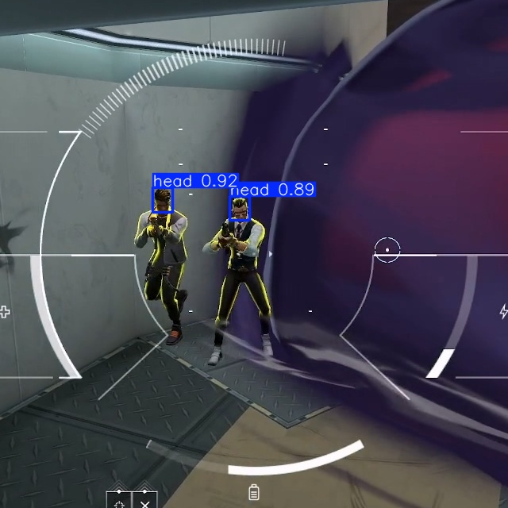
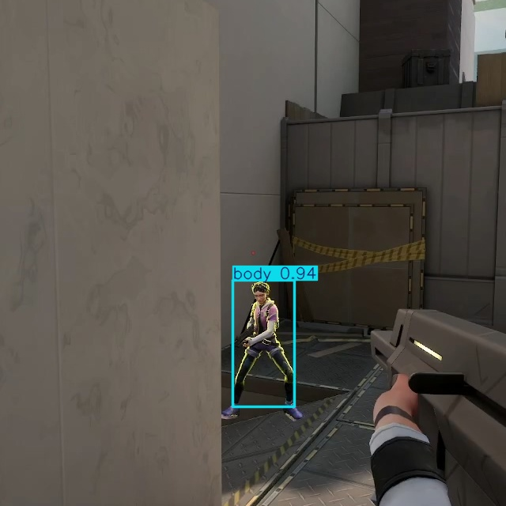
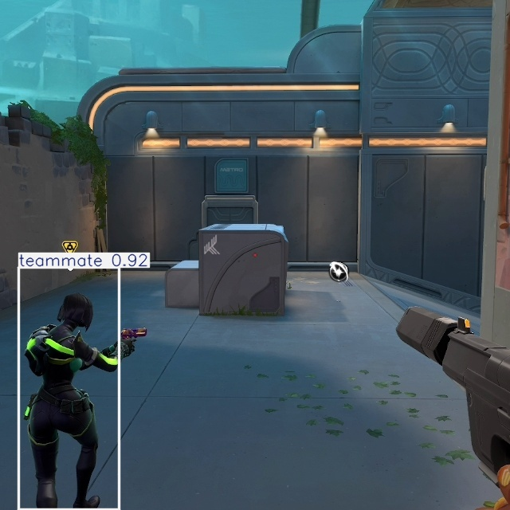
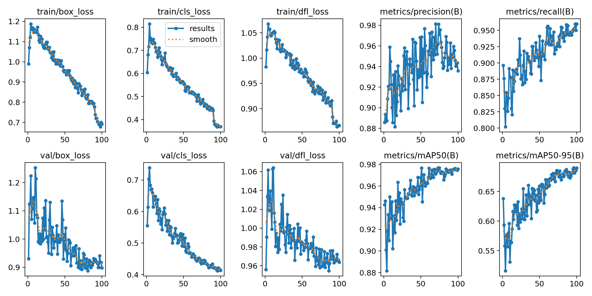
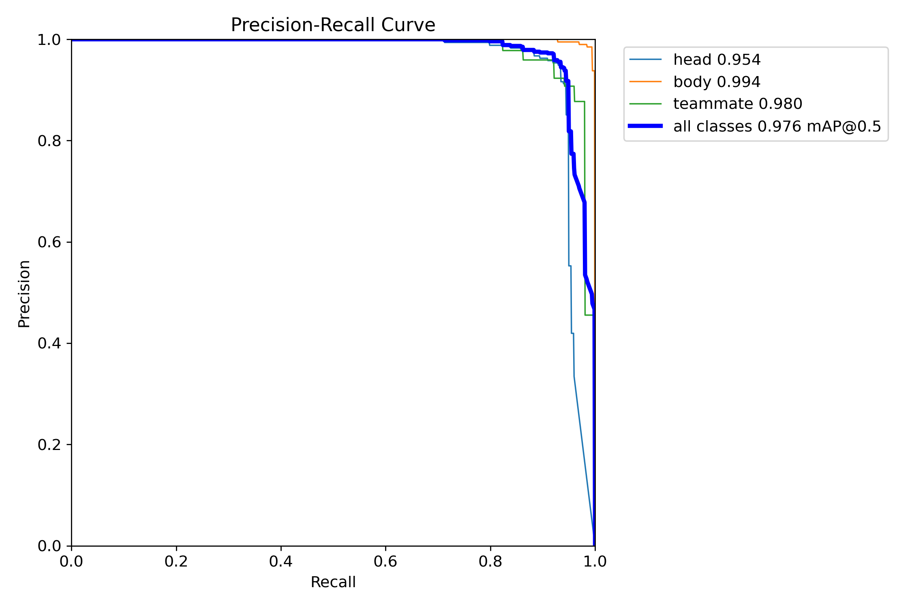
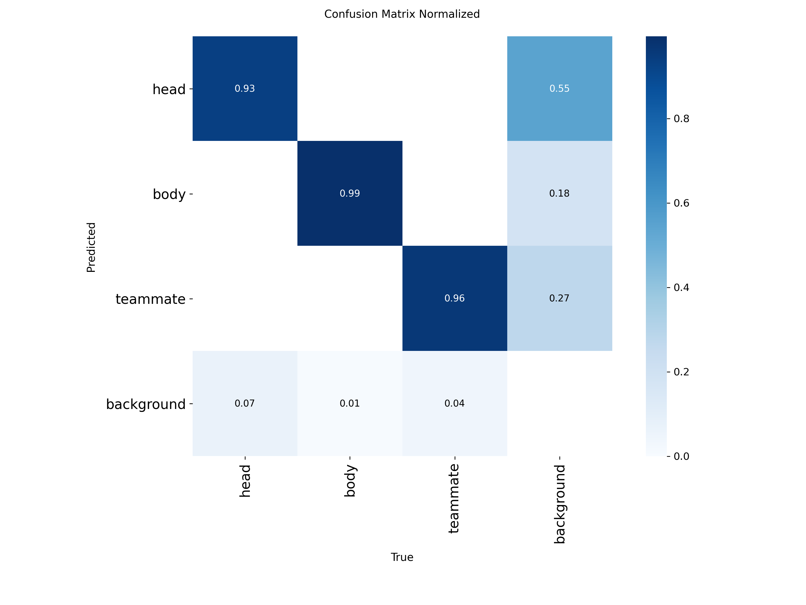

# FPS 游戏人物检测 (YOLO)

**中文 | [English](README_EN.md)**

计算机视觉研究项目：使用 YOLO 检测 FPS 游戏（瓦罗兰特）中的人物。流程：游戏截图中心裁剪 640×640 → YOLO 训练 → 推理检测。

> ⚠️ **仅供研究与教育用途**，请仅离线使用自己的录像素材。
> 训练集为 2026 年初的对局截图，**较新的地图/新角色未加入训练集**，在这些新内容上识别效果可能下降；如需适配，请补充新截图标注后继续微调。

## 识别效果（验证集实测）

| head（头部） | body（身体） | teammate（队友） |
|:---:|:---:|:---:|
|  |  |  |
| 置信度 0.92 | 置信度 0.94 | 置信度 0.92 |

## 训练结果

| 训练曲线（loss / mAP） | PR 曲线 |
|:---:|:---:|
|  |  |

**混淆矩阵（归一化）**



验证集指标：**mAP@0.5 = 0.976，mAP@0.5:0.95 = 0.690**（head/body/teammate 三类）。

## 快速上手

仓库自带训练好的模型 `models/best.pt`（YOLO11n 微调，三类：head/body/teammate），无需训练即可直接使用：

```python
from ultralytics import YOLO

model = YOLO('models/best.pt')
results = model.predict('截图.png', conf=0.25, imgsz=640)
print(results[0].boxes)  # xyxy, conf, cls
```

模型按 **640×640 中心裁剪图**训练，对整屏截图直接推理会因缩放而精度下降——建议先用 `crop_center.py` 裁剪到 640×640 再推理（或推理时 `imgsz=640`）。

## 数据集

本仓库**不包含**训练数据集（约 1200 张带标注截图）。如需复现，请自行采集截图并标注（如 LabelImg），按以下结构组织：

```
datasets/
  images/train/  images/val/
  labels/train/  labels/val/   # YOLO txt 格式: cls cx cy w h（归一化坐标）
```

类别：`head`(0) / `body`(1) / `teammate`(2)

## 流程

1. **裁剪** `crop_center.py` — 截图中心裁剪 640×640（避免整图缩放导致人物压扁）
   ```
   python crop_center.py -i 截图文件夹 -o new_data/images -s 640
   ```
2. **视频抽帧** `val_video.py` — 从对局录像抽帧并交互式筛选
   ```
   python val_video.py -v 录像.mp4 -m models/best.pt -o new_data/images
   ```
3. **训练** `train.py` — 基于 YOLO11n，配置见 `data.yaml`
4. **导出** `export.py` — 导出 TensorRT engine（半精度，推理更快）
5. **推理** `predict.py` — 批量测试，结果存 `runs/predict/`

## 环境要求

- Python 3.10+
- `pip install ultralytics opencv-python`
- 推荐 CUDA 版 torch（`device=0`）；无 GPU 时改用 `device='cpu'`

## License

代码：MIT — 见 [LICENSE](LICENSE)。
模型权重 `models/best.pt` 基于 AGPL-3.0 的 Ultralytics 底座微调，分发/再发布请遵守 AGPL-3.0；依赖的 Ultralytics 亦为 AGPL-3.0。
