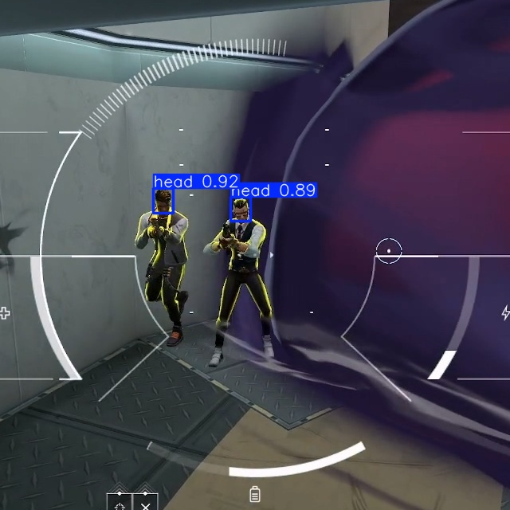
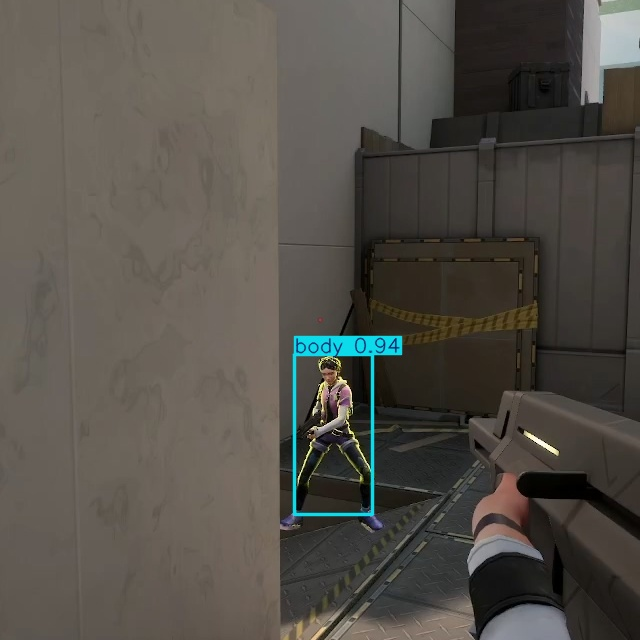
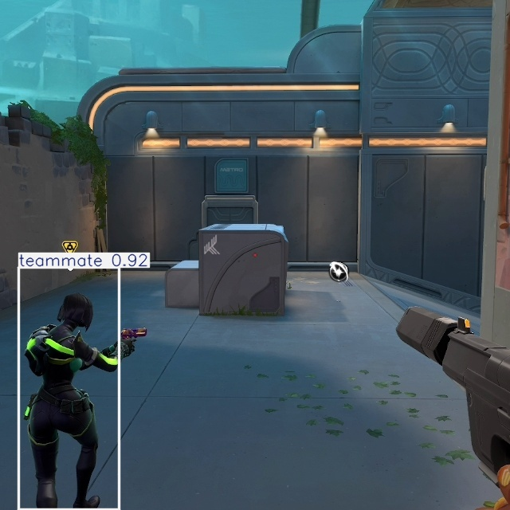
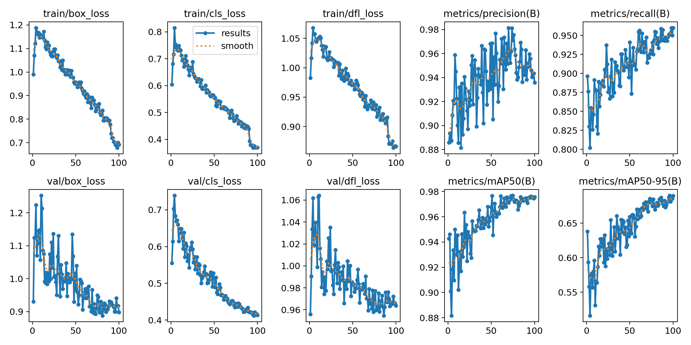
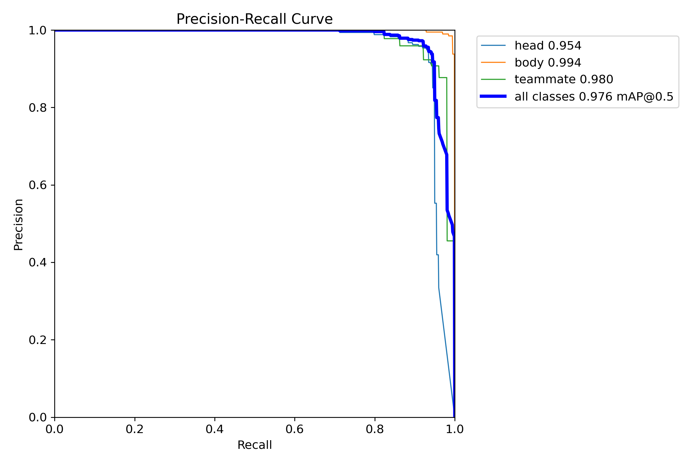
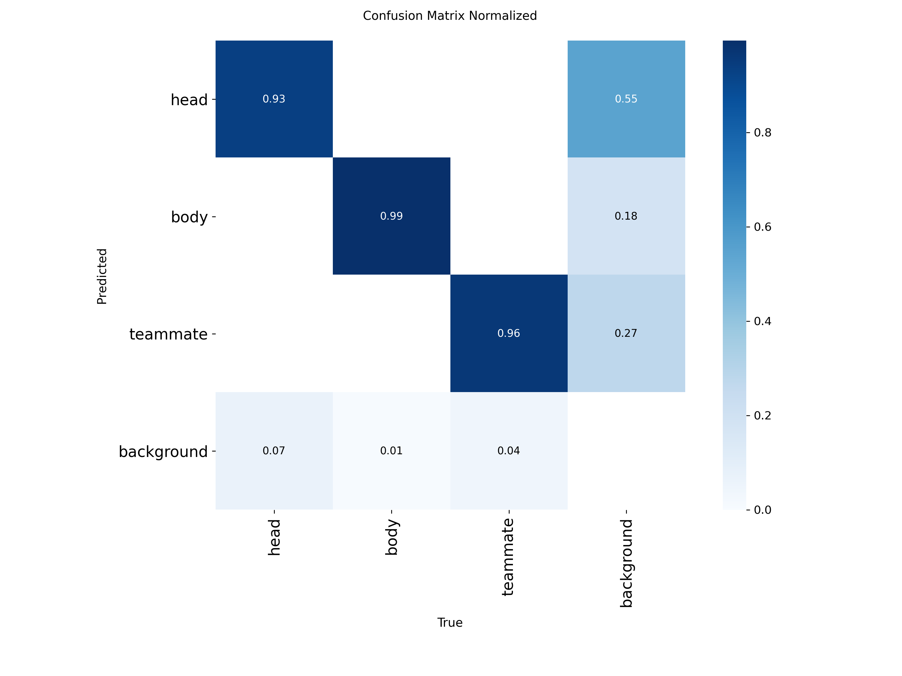

# FPS Game Player Detection with YOLO

**[中文](README.md) | English**

Computer-vision research project: detect players in an FPS game (Valorant) using YOLO.
Pipeline: center-crop game screenshots to 640×640 → train a YOLO model → run inference.

> ⚠️ **For research and educational purposes only.** Use offline / on your own recordings.
> Not affiliated with or endorsed by Riot Games.
> The training set covers early-2026 match screenshots only — **newer maps and newly
> released agents are not included**, so detection quality may drop on those.

## Detection Results (validation set)

| head | body | teammate |
|:---:|:---:|:---:|
|  |  |  |
| conf 0.92 | conf 0.94 | conf 0.92 |

## Training Results

| Training curves (loss / mAP) | PR curve |
|:---:|:---:|
|  |  |

**Confusion matrix (normalized)**



Validation metrics: **mAP@0.5 = 0.976, mAP@0.5:0.95 = 0.690** (3 classes: head/body/teammate).

## Quick Start

A trained model `models/best.pt` (YOLO11n fine-tuned, 3 classes: head/body/teammate) is included — no training needed:

```python
from ultralytics import YOLO

model = YOLO('models/best.pt')
results = model.predict('screenshot.png', conf=0.25, imgsz=640)
print(results[0].boxes)  # xyxy, conf, cls
```

The model was trained on **640×640 center crops**; running it directly on full-screen
screenshots loses accuracy due to resizing — crop with `crop_center.py` first (or use
`imgsz=640` during inference).

## Dataset

The training dataset (labeled game screenshots, ~1200 images) is **not included** in this
repository. To reproduce, collect screenshots and label them (e.g. with LabelImg), then
organize as:

```
datasets/
  images/train/  images/val/
  labels/train/  labels/val/   # YOLO txt: cls cx cy w h (normalized)
```

Labels: `head`(0) / `body`(1) / `teammate`(2).

## Pipeline

1. **Crop** `crop_center.py` — center-crop screenshots to 640×640 (avoids squashing players when resizing the full frame)
   ```
   python crop_center.py -i <screenshot_dir> -o new_data/images -s 640
   ```
2. **Extract frames** `val_video.py` — sample frames from a match recording with interactive review
   ```
   python val_video.py -v <video.mp4> -m models/best.pt -o new_data/images
   ```
3. **Train** `train.py` — YOLO11n base, config in `data.yaml`
4. **Export** `export.py` — export to TensorRT engine (FP16, faster inference)
5. **Inference** `predict.py` — batch inference, results saved to `runs/predict/`

## Requirements

- Python 3.10+
- `pip install ultralytics opencv-python`
- CUDA-enabled torch recommended (`device=0`); fall back to `device='cpu'` otherwise

## License

Code: MIT — see [LICENSE](LICENSE).
The model weights `models/best.pt` are fine-tuned from an AGPL-3.0 Ultralytics base;
redistribution must comply with AGPL-3.0. The Ultralytics dependency is also AGPL-3.0.
